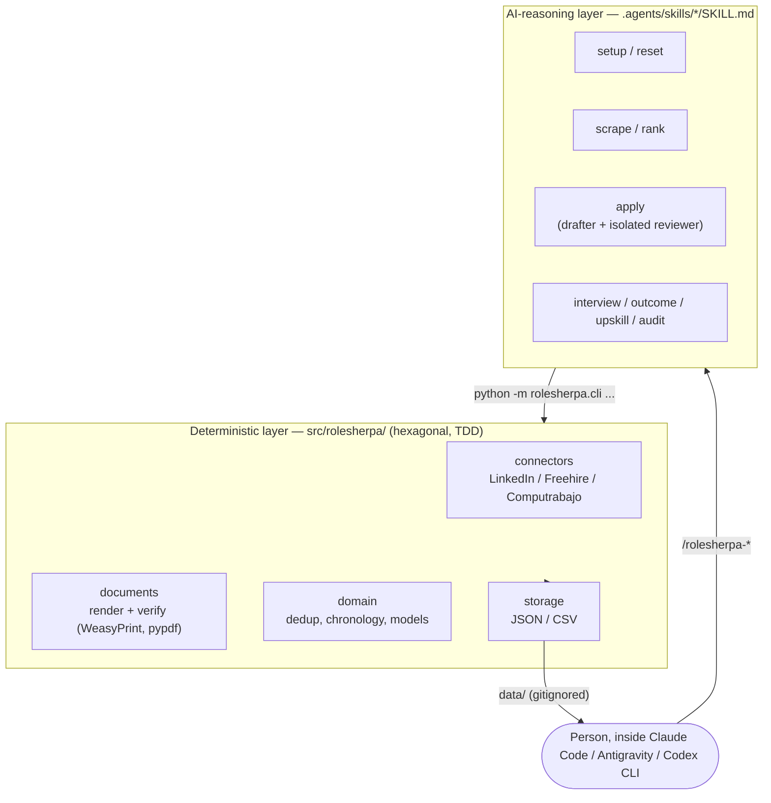

# OptimizeCV

**An AI-native job-search copilot that runs inside your coding agent — no separate app, no API bill, no dashboard to check.**

RoleSherpa evaluates job postings against a real candidate profile, drafts tailored CVs and cover letters through an isolated drafter/reviewer pass, verifies the rendered PDFs before showing them to you, and keeps the whole search organized — all as a set of natively-loaded skills inside **Claude Code**, **Google Antigravity**, or **OpenAI Codex CLI**.

---

## Why this project?

Job searching is a second job: re-reading the same posting five times to decide if it's worth applying to, tailoring a CV without silently inventing experience you don't have, remembering which recruiter you already talked to, and prepping for an interview from scratch every time. Generic AI chat can help with any one of those steps in isolation, but it forgets everything between sessions, has no memory of your actual work history, and nothing stops it from politely fabricating a bullet point that sounds plausible.

RoleSherpa exists to fix that: a structured, repeatable, **anti-fabrication-first** workflow — fit evaluation before drafting, a reviewer pass that never touches the same context as the drafter, and a verification checklist that has to pass before any document reaches you — built as real, tested software instead of a pile of one-off prompts.

It started as a personal tool for automating my own search. This repository is the curated, public version of it, shared as a demonstration of how I build software: spec-driven, test-first, and honest about trade-offs.

---

## Key Features

- **Runs natively in three AI hosts** — Claude Code, Antigravity, and Codex CLI all discover the same skill files directly; no separate integration per host, no extra subscription.
- **Fit evaluation before drafting, always** — a posting is scored against the candidate's real profile first; nothing gets drafted until that evaluation is presented and the user explicitly says go.
- **Isolated drafter/reviewer pass** — the reviewer that critiques a draft and researches the company runs as a separate agent dispatch, never re-reading the drafter's own reasoning, so the critique is an honest second opinion rather than the same model agreeing with itself.
- **Verification before presentation, not after** — every generated CV/cover letter is rendered to PDF and checked (exact page count, real text-layer extraction, required-keyword coverage, an anti-fabrication claim-by-claim diff against the profile) before it's ever shown to the user.
- **Three real job-portal connectors** — LinkedIn, Freehire, and Computrabajo Uruguay, implemented in Python against their actual HTML/APIs (not scraped through a third-party service), with the portals that structurally can't be automated (robots.txt, bot-detection) explicitly documented rather than silently skipped.
- **A real deterministic core, not just prompts** — job-portal search, PDF rendering/verification, deduplication, and the application tracker are a tested, hexagonal Python library; only genuinely judgment-requiring steps (fit evaluation, writing, interview coaching) are delegated to the LLM.
- **Chronology auditing** — a dedicated command detects employment gaps, overlaps, and impossible date ranges in the candidate's profile before they end up unnoticed in a generated CV.

---

## Architecture Overview

RoleSherpa is deliberately split into two layers that almost never blur into each other: everything requiring judgment lives as prose the AI host executes directly; everything deterministic is real, tested Python code the skills call into.



- **AI-reasoning workflows** (fit evaluation, drafting, interview prep, upskill analysis) are pure `SKILL.md` prose — no separate LLM API call, no billed router. They run on whichever host's own model and subscription is active.
- **Deterministic logic** (portal search, PDF render/verify, dedup, storage) never asks a model to "carefully do the math" — it's tested Python the skills invoke as a CLI, hexagonal (ports & adapters) so the storage/rendering backends are swappable without touching skill prose.
- **Personal data lives in `data/`**, gitignored end-to-end — never inside the skill tree itself (see [Design Decisions](#design-decisions)).

---

## Technology Stack

| Layer | Choice |
|---|---|
| Language / runtime | Python 3.14, managed with [`uv`](https://docs.astral.sh/uv/) |
| AI hosts | Claude Code, Google Antigravity, OpenAI Codex CLI (via the [Agent Skills](https://agentskills.io) open format) |
| Portal connectors | `httpx` + `selectolax` |
| Document pipeline | `weasyprint` (HTML/CSS → PDF) + `pypdf` (verification) |
| Storage | Plain JSON / CSV files — no database engine |
| Config | `pyyaml` (connector registry) |
| Testing | `pytest`, TDD (red-green-refactor) throughout |
| Spec workflow | Internal spec-driven change process — every change ships a proposal / design / task breakdown before code |

---

## Installation

```bash
git clone https://github.com/c-ibarra/rolesherpa-portfolio.git
cd rolesherpa-portfolio
uv sync
```

Requires Python 3.14+ (uv installs it automatically if missing) and one of the three supported AI hosts (Claude Code, Antigravity, or Codex CLI) to actually run the skills — the Python package alone only gives you the deterministic CLI, not the reasoning layer.

## Quick Start

1. Open the repo in any of the three supported hosts.
2. Run the onboarding skill and follow its prompts:
   ```
   /rolesherpa-setup
   ```
   This builds your candidate/behavioral profile under `data/profile/` (gitignored — see [Configuration](#configuration)) and your search criteria, either by reading documents you provide, a pasted CV, or a short structured interview.
3. Search for postings:
   ```
   /rolesherpa-scrape
   ```
4. Evaluate and draft against a specific posting:
   ```
   /rolesherpa-apply <job posting URL>
   ```

## Usage Examples

```
/rolesherpa-scrape
> Searched LinkedIn, Freehire, Computrabajo Uruguay for your top 3 priority
> role categories. 7 new postings found, 2 excluded as closed/expired.
> Portals not searched this run: BuscoJobs (robots.txt disallows Claude-
> derived agents), Indeed UY (active bot-detection challenge)...

/rolesherpa-apply https://example.com/careers/senior-data-scientist
> Fit Evaluation: Senior Data Scientist at Example Corp
> | Dimension          | Score  |
> | Technical Skills   | 82/100 |
> | Experience Match   | 68/100 |
> | Behavioral Fit     | 74/100 |
> Overall: Good Fit (75/100). Should I proceed with drafting?
```

Every generated document is verified — page count, keyword coverage, and a fabrication check against the stored profile — before it's presented, not after.

## Common Use Cases

- **Evaluate a single posting quickly** without committing to a full application — `/rolesherpa-apply` stops after the fit-evaluation table if you say no to drafting.
- **Batch-triage a backlog of postings** already collected — `/rolesherpa-rank` scores everything against the fit framework and returns a shortlist, no company research or document drafting involved.
- **Prep for a specific interview stage** using the actual submitted CV and any feedback already logged from earlier rounds — `/rolesherpa-interview`.
- **Find a skill gap before it costs you an offer** — `/rolesherpa-upskill` compares tracked postings against the profile and returns a prioritized, real (web-searched) learning plan.
- **Audit your own profile for chronology mistakes** — `/rolesherpa-audit` catches employment gaps/overlaps/impossible date ranges before they reach a generated CV.

## Project Structure

```
rolesherpa-portfolio/
├── .agents/skills/      # AI-reasoning workflows (SKILL.md), read by Antigravity + Codex CLI
├── .claude/skills/      # Byte-for-byte mirror, read by Claude Code
├── src/rolesherpa/      # Deterministic Python library (hexagonal)
│   ├── connectors/      # LinkedIn, Freehire, Computrabajo — JobSourcePort adapters
│   ├── documents/       # render + verify (WeasyPrint / pypdf)
│   ├── domain/          # models, dedup, chronology audit, host detection
│   └── storage/         # JSON / CSV StoragePort adapters
├── templates/           # CV / cover-letter / profile templates
├── config/sources.yaml  # Connector registry — enabled/blocked portals and why
├── data/                # Personal runtime state — gitignored, see Configuration
├── documents/           # Personal source docs for onboarding — gitignored
├── tests/               # pytest suite, mirrors src/ + tests/skills/ for prose contracts
├── docs/adr/            # Architecture Decision Records
├── docs/assets/         # README images (e.g. the banner above)
├── AGENTS.md            # Living project conventions (read by all three hosts)
├── LICENSE              # MIT
└── CONTRIBUTING.md      # Contribution policy for this repo
```

## Configuration

- **`config/sources.yaml`** — which portal connectors are active, and the documented, tested reason any of them are disabled (robots.txt rules, bot-detection walls, client-side-only rendering) — never a silent omission.
- **`data/`** — all personal runtime state: the candidate/behavioral profile, search criteria, the application tracker, and the per-application document archive. Entirely gitignored; see `data/README.md` for the exact layout. `templates/profile/` holds the blank versions `rolesherpa-setup`/`rolesherpa-reset` bootstrap from.
- **`documents/`** — where you drop your real CV, LinkedIn export, diplomas, and reference letters for onboarding to mine. Gitignored; see `documents/README.md`.

No environment variables or API keys are required — the AI-reasoning steps run on the host's own model access, and the deterministic library needs no external service credentials.

## Roadmap

- [ ] Continuous integration (test suite currently runs locally only)
- [ ] Additional portal connectors beyond the current three, evaluated case-by-case against each site's actual access terms
- **Explicitly out of scope:** headless/scheduled/unattended operation. RoleSherpa is interactive-only by design — see `docs/adr/`.

## Testing

```bash
uv run pytest          # full suite (integration tests excluded by default)
uv run pytest -m integration   # tests that hit real live endpoints
```

TDD end to end: every non-trivial change lands as a failing test first, then the minimal implementation to pass it. `tests/skills/` holds the same discipline applied to the prose layer — tests that assert on real `SKILL.md` content (e.g. that every skill's `allowed-tools` frontmatter actually grants what its own instructions require, or that the two mirrored skill trees never drift).

## Contributing

This is a personal portfolio project and I'm not actively looking for external contributions, but it's MIT-licensed — forks, adaptations, and pull requests with small fixes are welcome. See [`CONTRIBUTING.md`](CONTRIBUTING.md) for details, and [`AGENTS.md`](AGENTS.md) for the engineering conventions (TDD, hexagonal architecture, spec-driven changes, an ADR for every non-obvious decision) this project follows.

## License

MIT — see [`LICENSE`](LICENSE).

## FAQ

**Does this replace a real job search, or automate it end-to-end?**
Neither — it removes the repetitive parts (re-scoring the same posting, re-writing the same bullet points, forgetting earlier interview feedback) so the parts that need a human — deciding whether an offer is right, negotiating, actually interviewing — get more attention, not less.

**Why not just paste postings into a general-purpose AI chat?**
A chat session forgets your profile the moment it ends, has no verification step, and nothing stops it from inventing a plausible-sounding achievement. RoleSherpa's fit-evaluation gate, isolated reviewer pass, and rendered-PDF verification checklist exist specifically to close those gaps.

**Does it use my resume data to train anything, or send it anywhere unexpected?**
No. All personal data stays local, under gitignored `data/`/`documents/` directories — it never ships in this repository, and the AI-reasoning steps run through whichever host and subscription you're already using, not a separate billed API.

**Which AI host do I need?**
Any one of Claude Code, Google Antigravity, or OpenAI Codex CLI — the skills are written once and load natively in all three (see [Design Decisions](#design-decisions) for the caveats).

## Contact information

Carlos Ibarra — [linkedin.com/in/carlosibarra](https://linkedin.com/in/carlosibarra)

---

## What This Project Demonstrates

For anyone evaluating this as a portfolio piece rather than just a tool:

- **Agentic AI system design** — a workflow spanning fit evaluation, isolated drafter/reviewer critique, tool-scoped skills, and multi-host portability, built on the open Agent Skills format rather than a single vendor's proprietary extension mechanism.
- **LLM integration with real guardrails** — an explicit anti-fabrication check that diffs every factual claim in a generated document against a structured profile, not just "be honest" in a prompt.
- **Software architecture** — hexagonal (ports & adapters) separation between deterministic logic and AI reasoning, so the two are independently testable and neither leaks into the other.
- **Test-driven development** — the deterministic Python layer and the skill-prose layer are both under TDD discipline; see [Testing](#testing).
- **Spec-driven development** — every non-trivial change ships as a written proposal/design/task breakdown before implementation, archived afterward as a permanent record.
- **Documentation as an engineering artifact, not an afterthought** — Architecture Decision Records for every non-obvious call, including ones that revise or narrow an earlier finding (see `docs/adr/0004`, which found and documented real limits in a claim made by `docs/adr/0003`).
- **Data-privacy engineering, applied to a real incident** — see the next section.

## Design Decisions

A few of the trade-offs that shaped this project, with the full reasoning in `docs/adr/`:

- **No separate LLM API, no billed router.** The AI-reasoning steps run on whichever host (Claude Code, Antigravity, Codex CLI) is currently active, using that host's own model and subscription — a deliberate rejection of building (and paying for) a dedicated inference service for an interactive, human-in-the-loop tool.
- **Skills mirrored into two trees, not one.** `PROJECT_BRIEF.md` originally assumed a single `.agents/skills/` location would load natively in all three hosts. A live bug report proved that assumption two-thirds right: Claude Code only reads `.claude/skills/`. Rather than quietly special-casing one host, every skill is now mirrored byte-for-byte into both trees, with a dedicated test (`tests/skills/test_skill_mirrors_stay_in_sync.py`) failing the suite the moment they drift (`docs/adr/0003`).
- **That parity claim was then narrowed, not just trusted.** A follow-up investigation checked whether the frontmatter mechanisms the skills actually rely on (`allowed-tools`, `context: fork`) are equally portable — they aren't. Both are Claude-Code-specific; verified directly against the open Agent Skills spec and Antigravity's/Codex CLI's own docs, not assumed (`docs/adr/0004`).
- **WeasyPrint (HTML/CSS) over LaTeX for document rendering**, even though the reference implementation used LaTeX — a heavy, non-Python toolchain that can't be unit-tested structurally. WeasyPrint's templates are parseable, testable Python-native artifacts (`docs/adr/0001`).
- **Personal data lives outside the skill tree, on principle, not just convention.** Candidate profile and search-criteria data used to live partly inside the tracked, mirrored skill directories — until that coupling caused a real, working-session PII leak (real contact info committed as a side effect of an unrelated skill edit). The fix wasn't a one-off patch; it's now an enforced project rule (`data/` only, gitignored, never inside `.agents/skills/`/`.claude/skills/`) with dedicated test coverage (see `tests/skills/test_profile_data_outside_skills_tree.py`).
- **Plain JSON/CSV storage, no database.** The application tracker and dedup state are low-volume, single-user, and human-readable-by-design — a `StoragePort` protocol keeps the option open to swap backends later without it being a decision that needed making now.

---

*See [`AGENTS.md`](AGENTS.md) for the living conventions every skill and AI host follows today.*
